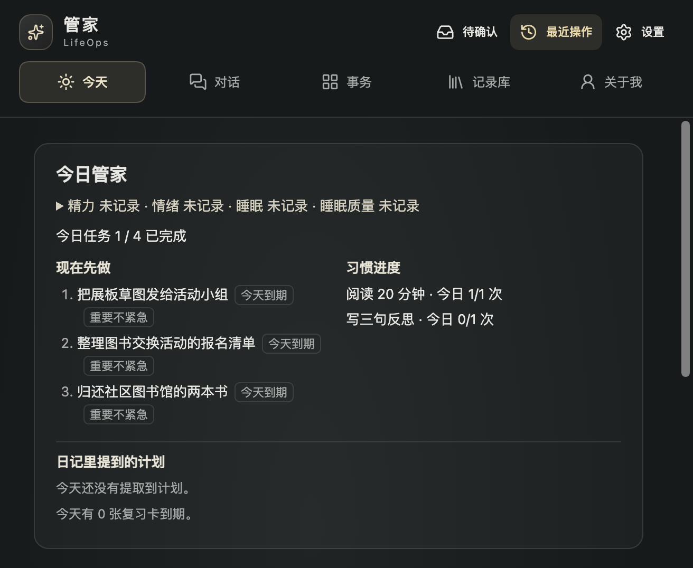
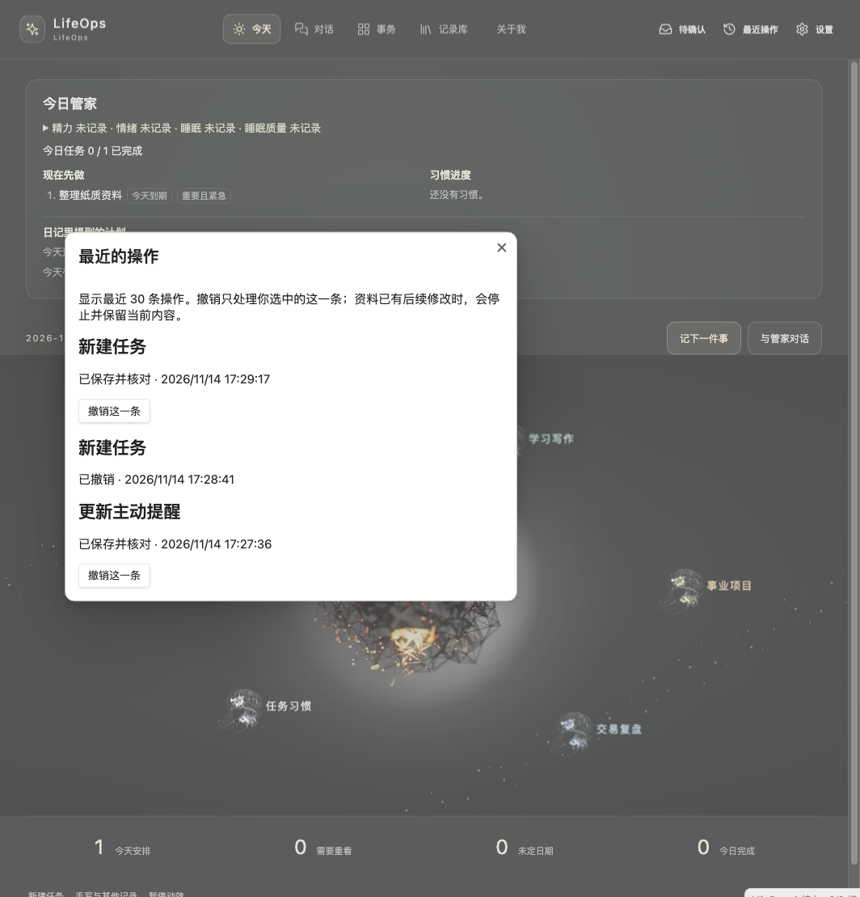

# LifeOps Assistant

LifeOps 是一个 Obsidian 插件。用同一个面板管理任务、打卡、日记和复盘。日常记录保存在你选择的库里；需要文字 AI 或语音时，可以自行配置服务。



## 安装

安装包和版本说明可从 GitHub 发布页获取。[下载最新版本](https://github.com/john-booen/lifeops/releases/latest)

当前提供桌面端手动安装。社区目录提交步骤见[维护者发布说明](docs/COMMUNITY_RELEASE.md)。

1. 从你信任的发布渠道拿到同一版本的 `main.js`、`manifest.json` 和 `styles.css`。开发者可按下方命令自己构建。
2. 在一个 Obsidian 库的 `.obsidian/plugins/lifeops-assistant/` 放入这三个文件。打开该库（如果库已经打开，复制完先重载该库）。Obsidian 可能会提示确认仓库来源。自己创建的库和文件来源都确认无误后，按提示操作，再到「设置 → 第三方插件」启用 LifeOps Assistant。
3. 在命令面板搜索「打开 LifeOps 面板」，首次选择「这台负责处理」（单台使用也选此项），再在向导选「开始本地使用」。试建一项任务，再到「最近操作」选择对应条目并点击「撤销这一条」。
4. 可选：到「设置 → LifeOps Assistant」配置文字 AI 或语音。打开对应的数据发送开关前，先核对服务和发送范围。



在新库试用时，任务、日记、习惯和报告放在 `LifeOps/` 下。助手名称和可选首页视频可在 LifeOps 设置中修改，视频使用库内文件。使用已有库前，先备份库文件和插件设置。交易功能用于记录和复盘。

插件清单声明最低版本 Obsidian 1.5.0。0.5.107 已在官方 macOS Obsidian 1.5.8 和 1.12.7 的虚构库验收聊天复制、键盘编辑、批量改时、改名后继续新增、连续确认、撤销、跨周原文与按日覆盖、设备收件、重开与旧版回退。1.5.0 和其他桌面系统仍待实测；这项原生检查未使用真实麦克风或第二台设备。反馈安装问题时请附上 Obsidian 版本。

更新或回退前，先用当前版本运行「检查并恢复未完成操作」。检查完成后退出 Obsidian，备份整个库，并保留当前版本的安装文件。需要回退时，在插件目录换回同一旧版本的 `main.js`、`manifest.json` 和 `styles.css`，保留当前的 `data.json` 和库内记录。重新打开后，在「设置 → 第三方插件」核对版本，再打开面板检查最近的记录。涉及数据格式迁移时，先按该版本的发布说明核对兼容范围。

两台 Mac 与手机共用记录的配置和验收见[多设备使用说明](docs/DEVICE_SYNC.md)。先完成一台处理端设置，再连接其他设备。

## 模型与数据

- 「开始本地使用」可以手动管理任务、打卡和日记，无需模型账号。使用文字 AI 时，在「设置 → LifeOps Assistant → 文字 AI」选择服务、填写接口和模型。先在页面顶部确认 API Key 的本地明文存储风险，再填自己的 API Key。核对并打开文本发送开关。更换主用或备用服务的类型、地址后需重新确认。启用后，问题和本次功能所需的库内内容会发给配置的服务，例如 Kimi。
- 语音可在「语音对话」配置百炼，按所选模式发送音频或用于朗读的文字。Breeze 本地朗读需要自行配置 Python、模型和参考音频。启用视觉或向量检索时，所选图片或文本会按对应设置发送给配置的服务。
- 插件当前无强制付费或 LifeOps 账号。第三方服务可能要求账号和付费。当前版本将已配置的密钥保存在插件的本地设置文件 `data.json`，不要把它或含密钥的备份随代码分享。
- 可选的「外部只读资料库」仅访问你配置的库和目录，用于查阅资料。默认空库不接外部目录。启用 AI 后，发送范围仍由各功能的授权和排除目录控制。

## 开发

从干净副本开始，使用与 CI 相同的 Node.js 25.9.0。

```sh
npm ci --ignore-scripts --no-audit
npm run release:prepare
```

命令会运行类型检查和测试。通过后，安装文件和 `SHA256SUMS.txt` 在 `dist/lifeops-assistant/`。从这里取出安装步骤需要的三个文件。

开发和反馈只使用虚构资料。参见 [使用指南](docs/USER_GUIDE.md)、[架构说明](docs/ARCHITECTURE.md)、[数据格式](docs/DATA_MODEL.md)、[贡献指南](CONTRIBUTING.md)和[版本记录](CHANGELOG.md)。

## English

LifeOps is an Obsidian plugin for local tasks, habits, journals, and reviews. Optional text and voice services require explicit configuration and consent. Build it from source or install the three plugin files into a test vault, then follow the first-run guide. It does not place trades.
