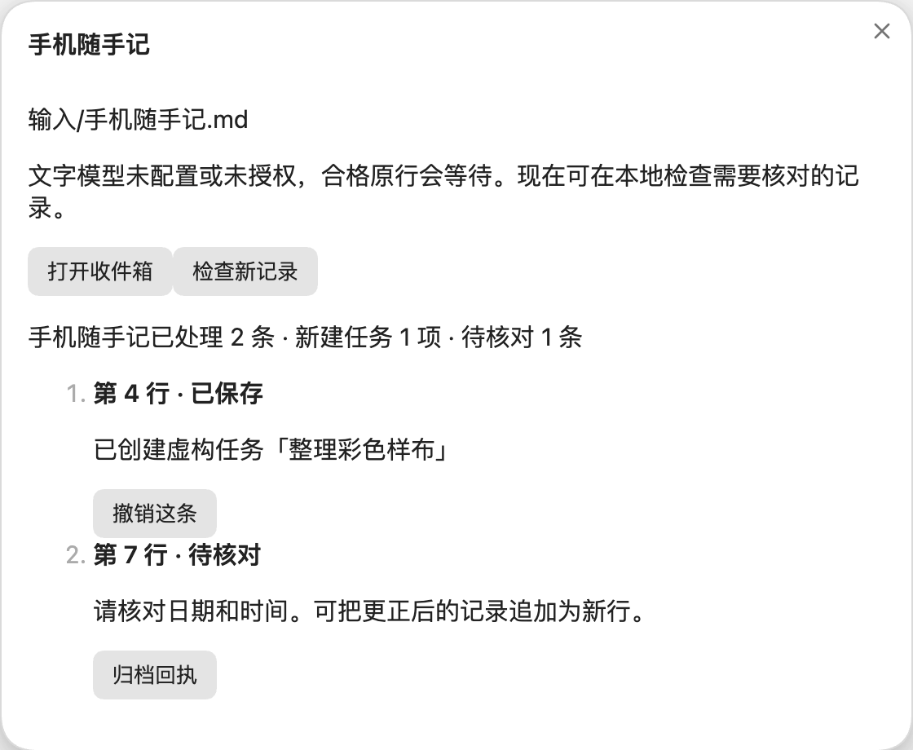
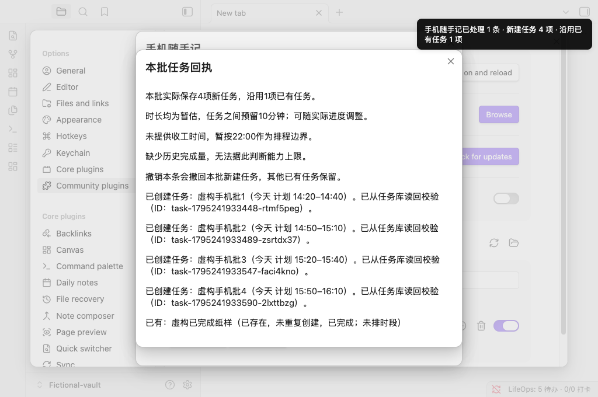
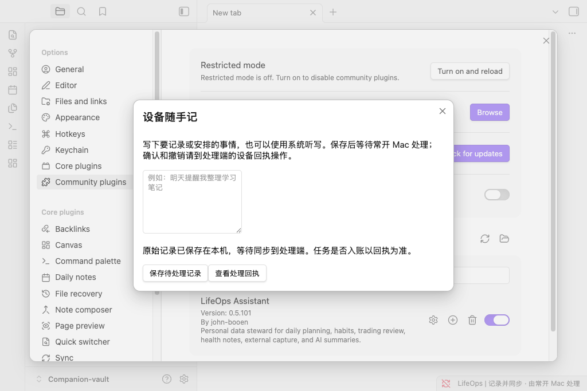

# LifeOps 使用指南

## 每天怎么用

- 早上打开「今天」，看待办、时间和习惯。也可以问「我今天先做哪几件事？」
- 手写日记时，在「今天」点「手写与其他记录」，选择「晨间日记」或「晚间日记」，再点「打开记录」。
- 白天想起一件事就直接说，例如「明天下午三点给样品盒贴标签」。听到回执后核对标题和时间，记错了可以说「撤销」。
- 晚上说「帮我记一段晚间日记」，接着说今天发生了什么。想回顾时问「今天完成了什么，还有哪些没做？」
- 如果听错了，先看面板的转写，重说错的词或切到文字。反馈时，说清原话大意、面板听成什么、你期待它怎么做。

在 Obsidian 的命令面板搜索「打开 LifeOps 面板」即可进入。用「今天」查看待办、习惯、日记状态和到期复习卡，在「事务」管理任务与习惯。提问或快速记录时，打开「对话」，可以打字或使用已配置的语音。

文字对话按 Enter 发送、Shift+Enter 换行，也保留 Cmd/Ctrl+Enter 发送。中文输入法选字时的回车不会发送。消息正文可选中后复制，也可点每条消息下方的「复制」；输入框可点击或用方向键移动光标编辑。

在 LifeOps 设置中可以修改助手名称。首页保留原有深色外观；如需视频，在「首页可选视频」填入库内 MP4 或 WebM 的相对路径。默认使用静态图。

## 语音对话

- 点「语音」并等到面板显示正在监听，再开口。说完停一下，系统会自动接收这句。默认静音判断为 700 毫秒，可在设置里调节。结束对话时点停止。
- 助手在朗读时可以开口打断。长总结会先回一句，再到后台整理。你可以接着问短问题，结果空闲时播报，也可在「语音后台任务」里查看。
- 长总结的完整文字和表格会保留在「语音后台任务」里。语音用几句话说结论、变化和下一步。口语整理不可用、数字不符或只回标题时，全文有足够事实就保留两三句完整原句；资料不足时提示回看面板全文。
- 说「上面那个不用了」可取消正在跑的任务。有多个任务时，助手会请你说清楚。后台结果被打断后，可以说「继续说刚才那个」。
- 建任务、打卡、记交易和记日记，听到保存回执后可以接着说「撤销」。助手会撤销你最近一次可以撤销的操作，并说清撤了什么。目标不明确时会请你指明，也可以在回执上点「撤销」。
- 刚把任务时间改错了，可以说「撤销刚才的修改」。例如先建明天15:15的任务，再改成16:00，撤销修改后恢复15:15，任务本身保留。
- 删除和超过三条的修改先统一确认。明确更正一至三条标题或备注时，直接修改原任务并给回执，保留原编号和安排。前文已经说清修改内容时，可接着说「确定」。
- 已有任务也可以整批调整开始和结束时刻，保留原编号和其他内容。模型写出的表格或“卡片已生成”文字不能代替实际确认卡；已查清单但缺少可执行修改时，系统会继续核对原请求，资料不足则明确说明尚未准备好。超过三条会显示一份完整的调整卡；紧接着只有这一份待确认计划时，可以回复「确认」或「确定」，也可以点击确认。任务在预览后被改过时，旧计划会停止保存，核对新内容后再准备。
- 修改和新增可以同段交代，例如：`把「蓝纸清单」改为「核对蓝纸清单」，把「绿盒归档」改为「检查绿盒清单」。保留原日期和时间，再新增一条明天17:00给紫色纸袋编号。` 核对回复里实际完成的两条更正和一条新增。
- 听写由已配置的百炼实时服务处理。可以按设置使用已配置的云端声音，或选用配置好的本地 Breeze。
- 单独问「今天是几号」或打招呼时，听写后的回复由本地生成。日期取自当前设备。
- 自动识别在支持热词的百炼地址优先使用热词。每次开始对话时，最多发送 50 个词，手填热词优先，其次是习惯名、交易品种、近七天任务关键词。
- 在 LifeOps 设置的「实时语音对话」里可补充自己的词，或切换到「百炼实时识别」。英文昵称反复听错时，可试着加入中文读音。切换识别方式后，重新核对发送范围。

## 日常记录

- 「我今天还有什么任务没完成？」或「今天应该先做哪些？」
- 「明天下午三点见客户」会建立任务。「把写周报改到明天」会改期。明确要求把整段事项全部创建时，会统一排程并保存，放不下的保留日期并提示延后风险；只要求草案时先看确认卡。
- 离线时可输入 `/todo 下周三 10:30 整理纸样`。也可用「大后天」「月底」或具体月日。
- 「我刚跑完五公里」会记录跑步。也可以问「这周习惯完成得怎么样？」
- 「今天有点焦虑，帮我记到晚间日记」可以追加日记。「我最近在焦虑什么？」可以按已有原文回顾。

任务和习惯也可在面板中手动改。完成、改期和打卡后可查回执。没有配置文字模型时，在「最近操作」找到对应记录，点击「撤销这一条」。配置并授权模型后，也可以在对话里说「撤销刚才那个」。

## 手机随手记

下文是已有的文件收件箱机制；完整的双Mac与手机接续对话、修改和确认尚未交付，真实多端尚未接入。手机即时记灵感是后续整体方案的重点，当前限制见[设备说明](DEVICE_SYNC.md)。

1. 在电脑的 LifeOps 设置中打开「手机随手记」，点「打开回执」→「打开收件箱」。插件在当前库里创建 `输入/手机随手记.md`。电脑端使用现有已授权的文字模型处理新行。
2. 在 Obsidian 手机版打开已同步的同一库，找到「输入」→「手机随手记」，每次在末尾追加一行并按回车。可用系统键盘听写。自动处理等到换行；可点「检查新记录」手动处理末尾尚未换行的一条。用能够向同一个库文件追加文本的快捷指令时，选同一路径，并在每条文字末尾加换行。
3. 经常隔天回电脑时，可在开头加 `[2026-01-09 16:20]`，例如 `[2026-01-09 16:20] 明天下午三点带样品`。相对日期以方括号里的日期计算。用随手记标记现有任务完成时，完成统计也按这一天计算。如果文字里明确说了完成日期，就用文字给出的日期。没有时间标签时，以电脑开始检查这批记录的日期为准。
4. 打开电脑后，首页「手机随手记」或命令面板「手机随手记回执」里会显示待检查记录的条数、末行是否还有待换行的文字，以及已生成的回执。确认删除前先核对对象。保存后如果回执中断，打开回执或点「检查新记录」会查本地操作账本。仍显示「待核对」时，可到「最近操作」查看保存结果。
5. 时间标签有残缺时，即使未连接文字模型，也可点「检查新记录」取得本地核对提示。把改好的记录追加为新行，原行可在回执中归档。
6. 插件会保留收件箱原文，跳过笔记属性、注释及代码块。疑似含密钥的行会留在本地并提示核对。发现这类提示时，去掉密钥后另追加一行。
7. 支持设备整批输入的版本中，同一行可写多件事，例如「今天折纸盒、贴标签、核清单、整理信封、装订纸本，各20分钟，全部创建并安排」。回执显示实际新增和已有数量，可查看完整清单或撤销本批；已有任务保留。隔天处理按录入日期保留计划，不倒填过去时段。

```text
手机：追加一行 → 同步到电脑
电脑：自动处理 → 回执 / 待确认 → 按条撤销
```



下图为0.5.101远端虚构库演示：五项输入中新增四项，沿用一项已完成任务。它说明桌面回执的样子，安卓实机仍需完成首次接入。



在两台设备打开同一个库后，先在手机追加一条虚构记录，例如「想法：做一张彩色样布索引」。到电脑打开收件箱，核对这行同步到了末尾，再打开回执检查。若电脑上的文件没有这行，先处理 Obsidian 的同步设置。

使用系统快捷指令时，把听写或输入的文本作为一行追加到 `输入/手机随手记.md`，并在末尾加换行。只能选到同一库里的这个文件时，再采用这种方式。

## 现有两台Mac设备随手记（能力有限）

当前机制尚不能在另一台Mac继续完整聊天、修改和确认；完整跨端结构仍待审阅。下面仅说明已有文件输入及回执的隔离演练，不是无缝跨端接入指引。

设备版中，常开的Mac选「这台负责处理」，另一台在首次同步完成后选「这台只记录并同步」。另一台用「设备随手记」输入整段内容，先保留原文，常开Mac处理后查看回执；确认和撤销集中在处理端。同步工具只传记录，模型设置留在本机，详细顺序见[同步说明](DEVICE_SYNC.md)。



## 健康记录

在 LifeOps 设置的「截图识别」里配置视觉服务并开启健康截图授权。命令面板选择「截图记健康」，选图并发送，核对识别到的日期和数值后保存。跨夜睡眠请填醒来的日期。可识别每日睡眠时长、步数、跑步距离、体重和静息心率。同日分成几条时可一起勾选。如果同一天同一指标出现不同数值，请修改或取消勾选其中一条。日用库里的健康 Markdown 笔记保留每次记录，统计采用同日每项最后一次有效记录。可在「最近操作」撤销。保存期间输入框暂时锁定。

首页显示昨晚睡眠和今日步数。可以问「这周设备记录的睡眠时长平均是多少？」或「今天手表记录的步数是多少步？」。明确查询睡眠时长、步数、跑步距离、体重或静息心率时，回复可由本地记录计算。跨多天查询步数或跑步距离时，请说明要合计还是平均。日摘要、周摘要会纳入已记录的指标。可在习惯的「记录方式」中选择用步数、跑步公里数或体重记录自动打卡。体重打卡表示当天有记录，健康来源只统计进度。原图只在你选择并点击发送时交给已配置的视觉服务。

已有通用健康表格时，在命令面板选择「导入健康 CSV」，粘贴表格，核对预览再确认。日期用 `YYYY-MM-DD`。表头可用中文指标名，也可用 `date,sleepHours,steps,runningKm,weightKg,restingHeartRate,exercise,fatigue,energy,note`。数值单位分别为小时、步、公里、公斤和次/分。睡眠按分钟记录时，请用 `sleepMinutes` 或「睡眠分钟」替代小时列，预览会显示换算后的小时数。留空表示该项没有数据。

同一个指标只保留一列，例如「步数」和 `steps` 选其一。疲劳和精力可填 1 到 10。

## 想法和阅读

说「记下这个想法，做一个书单索引，先试三个主题」。到「记录库」里的「想法」看分组、下一步和检查日期。说「帮我把书单索引拆成本周任务」，会先给确认卡，卡上的任务和日期可以先核对。

在「想法」里点「查找历史想法」或「核对新想法」。点「扫描近 90 天日记」会用设置里启用的模型提取允许范围内的日记信号。候选可登记、合并来源或忽略。给已有笔记登记时会先列出改动，确认后补属性，保留正文。

候选里夹杂习惯或待办时，可点「筛查已有日记候选」。筛查用候选标题和摘句，结果可在「最近操作」撤销。

新增或修改阅读笔记时，可用 `source` 或 `url` 标明出处，也可以在设置里填「阅读来源文件夹」。之后可以问「最近读的文章里，有什么和书单索引有关？」回答会带库内笔记链接。

## 学习和复习

到「记录库」里的「学习轨道」查看英语、交易系统、量化和 AI。选择一条生成计划，改好目标、每周时长、资料目录和单元，再确认保存。命令面板的「调整学习计划」可以拟定下周计划。

可以说「我今天学了 40 分钟英语」或「我的英语学习进度怎么样？」学习笔记更新和关联任务完成也会留记录。填写的实际分钟会计入周目标。

轨道有学习笔记后，可以说「考我三道量化题」，再按题号作答。管家会解释判分，复习日期会更新。到期张数可在「今日」查看。

## 读统计与历史摘要

从0.5.116起，可以问「解释某段日期的任务计划完成率、平均完成间隔和估时的含义，只查记录」。这类口径问题由本地统计直接回答：登记到完成的经过时间包含等待和跨日，不是实测工时，不能据此推断拖延或临时需求挤占；同周隔天完成不等于周计划外。

任务平均完成分钟记录的是从登记到完成的经过时间，可能包含等待和跨日；估时和计划起止也都不是实测工时。整周计划完成率按整周范围核对，分日结果不能替代。空记录只表示没有登记，不能据此断言没有行动或交易绩效稳定。

历史摘要会保留生成来源、编辑状态和子摘要份数；周期完成标记不代表原始记录齐全。相对日期按原文叙述时点理解，建议不会自动变成计划或修改规则，原稿与手工补充保留。

## 交易复盘

说「今天 A 股某品种做多 100 股，20 开仓、22 平仓，手续费 5 元」。核对回执里的方向、数量、币种和盈亏。也可以用交易表单逐项填。

到「记录库」看交易，到交易复盘入口生成日、周、月报告。可以问「这个月交易多少笔？人民币和美元分别赚亏多少？」或「本周有哪些交易偏离了我保存的规则？」CSV 和历史笔记导入会先展示候选，再由你确认。

先在 LifeOps 设置配置视觉服务并确认图片发送范围。在聊天框按 Cmd+V 粘贴英文交易截图，LifeOps 会发送原图并打开确认卡。也可以从 Obsidian 命令面板打开「截图记交易」，选择 PNG 或 JPEG，再点「发送并识别」。确认卡会标明时区是否按市场推定。美股按美东时间，A 股和人民币计价期货按上海时间。对照截图核对方向、日期、时区和金额，再勾选保存。截图净盈亏和本地重算值不一致时会标出。缺少重算字段时，截图金额留在备注里，盈亏暂不入账。保存后可撤销。

核对期间交易库或乘数变化时，点「刷新核对」更新金额和重复项，再勾选要保存的记录。刷新使用已识别的内容。

## 管家摘要和提醒

从0.5.113起，日报会先说明可读日记与已纳入整理的篇数。尚未整理的原话不能据此判断为没有计划或没有行动，细节仍可在对话中按日期查原文。摘要继续使用已授权的统计、提取内容和用户对话，保留手改稿。

从0.5.114起，模型无法整理日报时，本地草稿还会保留最近几条当天对话原话，明确标为未整理片段。未决定的想法仍按原话显示，不会因此创建任务、宣布完成或写成长期记忆；完整内容可回看当天对话。

可以问「上周做得怎么样？」或「这个月和上个月比怎么样？」。日摘要在每天 23:30 生成，错过时下次开库补齐。周摘要在周日 21:30 生成，月摘要在月初整理上月。文件在默认的 `LifeOps/Output/AI/摘要` 目录，也可运行「生成日摘要」或「生成周摘要」。任务、计划、成交、健康、习惯或日记记录变化后，再次生成相应摘要会核对新输入；月摘要由原调度核对。更新下级摘要后，再生成上级摘要也会使用新内容。生成或保存期间记录变化时会停止保存，重新运行即可。手工改写过的摘要保留原文，输入未变时继续复用。周摘要开头分开显示任务指标和 CNY、USD 净盈亏。

支持持续补偿的版本中，首页和早间简报会提醒欠几项、拖了多久、现在要完成多少。开启朗读且语音会话正在监听、没有对话时，早间简报也会念出来。

反思每天默认增加 100 字，可在编辑习惯时改。公里和分钟分别核算运动上限，旧欠账优先。超量默认每公里记 20 元、每分钟记 3 元，可在 LifeOps 设置的「习惯」里修改。改价只用于此后新增的超量。

历史摘要用命令「补齐最近八周摘要」。确认页会显示资料范围，关闭后可以续跑。

在 LifeOps 设置里打开「主动提醒」，早间简报会在每天 7:00 至 11:00 的首次有效检查时出现，Obsidian 隔夜保持打开也能收到。当天的简报只发一次，可在 LifeOps 面板查看。23:00 至 7:00 静默。每条可点「知道了」「稍后」或「别再提这类」。

从0.5.111起，只读任务或交易统计已取得、后续模型答复中断时，数据仍能安全核对就会重新读取并先显示登记统计摘要。人民币、美元分开，未知盈亏不补零；界面会说明其余分析尚未完成。正在保存、权限改变或数据持续变化时继续保留原保护。这一步由本地计算完成，原写入流程保持。

从0.5.112起，主要文字服务刚返回限流时，接下来一分钟会先尝试已配置的备用服务，之后重新尝试主要服务。备用不可用时仍可尝试原服务；不会改写服务设置或增加新的发送渠道。取消和半截答复沿用原保护，诊断保留实际使用的渠道。

## 长期记忆和私人库

从0.5.116起，可以再次明确说「请记住这条偏好」并保留原句。原文绑定的旧推导保留归档，新陈述独立保存并给回执；在「最近操作」撤销可恢复原状态。回执中的「管家规则」等名称是记忆分类，不是另建同名文件；可在「关于我」的个人记忆中查看。已更正或遗忘的内容仍按原保护处理。

打开「关于我」查看记忆，可按类别搜索、编辑和删除。每条显示来源和时间。摘要提炼的记录带「摘要」标记，过期内容可在「已归档」筛选找到。

从0.5.110起，自动从上周摘要提炼长期记忆时，会逐字核对同日原始日记或用户会话，助手整理稿和推断不作为用户原话。旧的无依据自动记录保留并暂不用于聊天；原话支持的同一未确认记录可以直接补齐依据。原文变化后暂停使用旧理解，已确认、更正及遗忘的内容保留原规则。

日记周查询按指定日期读取所在周一至周日，保持隐私过滤及来源日期。长原文分页须使用准确路径，错误参数会提示正确读取方式。

跨周回顾已包含在0.5.108。可以围绕一个目标问「回顾某月某日至某日的归档，给我两份有日期的依据、一条共同现象和下周建议，不写入日程」。摘要缺失或更正后不可用时，会读取同范围日记的相关片段，注明来源和读取范围，按日期分开计算命中主题、有日记未提及、未找到和未读齐的天数，片段篇数另列。查询往年时写明年份；更正后的可用时段用于后续建议，不能当作历史事件的实际时刻。建议不会自动变成长期记忆或任务。已保存任务的聊天回执省去内部编号和重复校验尾句，可直接复制保留名称、日期、时段和状态的正文；撤销仍依据原记录。

在设置的「外部只读资料库」添加原私人库和要看的目录。查询可说「只查原私人库的交易复盘」，回答会标明来源。外部日记信号和历史交易各有单独的扫描入口，按提示核对资料范围。原笔记可通过查询读取，登记想法和确认交易写入日用库。

长报告口语整理不可用或报错数字时，正文有足够依据就保留两三句完整事实，数量仍对应原时段、对象、单位和正负；有效的定性说明可接在后面。表格单元格、代码和操作指令不会拼成事实，证据不足时会提示回看完整报告。报告正文保留，真人听感仍可自愿核对。

## 日记引用与历史复盘

日记中用Markdown块引用保留的他人观点，不自动作为本人的长期规则；原文和旧记录保留。本人明确通过确认卡采纳后，才可按相应依据使用；原文版本变化后会暂停。空的可用记忆查询只表示本次范围，没有删除保留的旧记录。

历史文本查询会先读取资料，再用已配置的模型单独整理最终正文。没打卡不等于没做，二手摘要也不等于当天事实。需要建议时请明确说明；适用查询会多一次推理请求，耗时随服务而变。若最终分析失败，会明确写出分析未完成，并显示本轮已读来源和原文片段，不复用未经核实的草稿。
